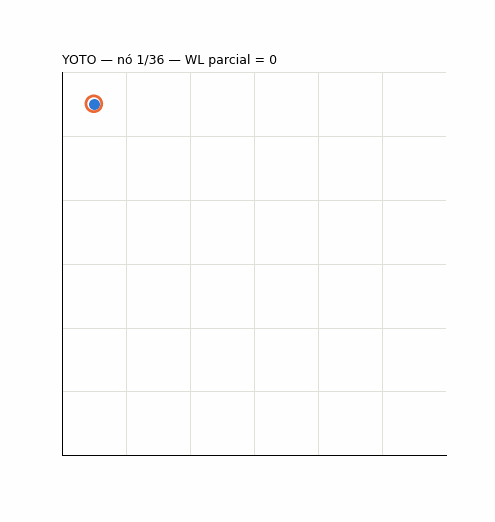
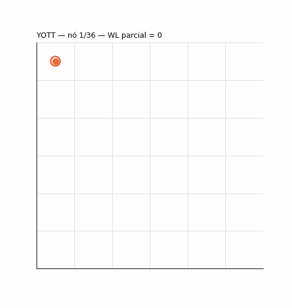
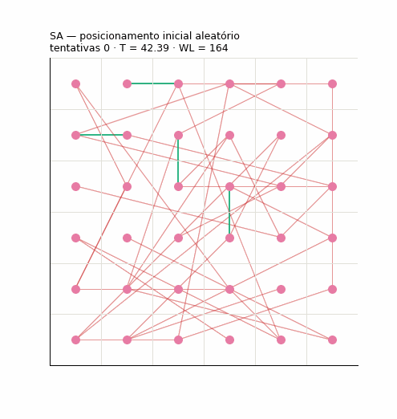

# YOTO × YOTT × Simulated Annealing

Compara três algoritmos que posicionam um grafo de fluxo de dados (DFG) numa grade 2D, buscando o menor comprimento
total das arestas (WL).

| YOTO | YOTT | SA |
|:---:|:---:|:---:|
|  |  |  |

## Como rodar

1. Abra o notebook no Colab pelo botão acima.
2. Clique em **Executar tudo**.

O notebook baixa só a pasta `data/` deste repositório e gera as tabelas, as figuras e os vídeos.

## Conteúdo

| Pasta / arquivo | Descrição |
|---|---|
| `INF610_Benchmark.ipynb` | todo o código: algoritmos, experimentos, figuras e vídeos |
| `data/real/` | 23 DFGs reais (LESC/UFV, licença MIT) |
| `data/synthetic/` | 35 grafos sintéticos, de 64 a 4096 nós |
| `data/optimal/` | 50 grafos com posicionamento ótimo conhecido |
| `gerar_datasets.py` | script que gerou `synthetic/` e `optimal/` |
| `videos/` | GIF dos posicionamentos acima |
